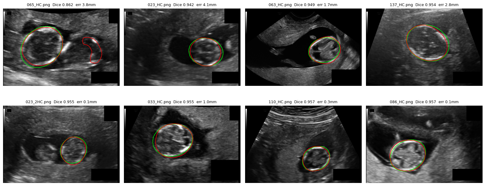
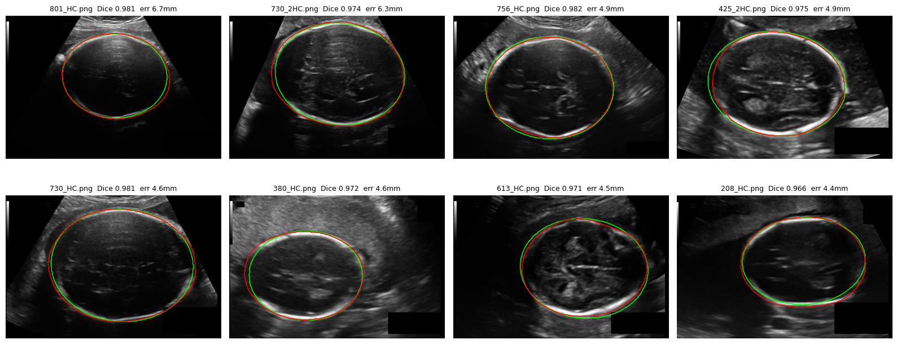

# Fetal Head Segmentation and Head Circumference Measurement (HC18)

This project segments the fetal head in 2D ultrasound images and measures the head circumference (HC) in millimetres from the predicted mask. It uses a pretrained U-Net fine-tuned on the public HC18 dataset, and checks the result both as a segmentation score (Dice, IoU) and as the clinical measurement a sonographer would take (HC error in mm).

## Results

Measured on a held-out test split that was never used for training or model selection.

| Metric | Result |
|---|---|
| Dice | 0.979 ± 0.014 |
| IoU | 0.959 ± 0.024 |
| HC absolute error, mean | 1.65 mm |
| HC absolute error, median | 1.23 mm |
| HC relative error, mean | 1.07 % |
| Cases within 3 mm | 83.2 % |
| Failed measurements | 0 |


## Data

HC18 dataset (Radboud University Medical Center, available on Zenodo). The 999 training images come with a sonographer's head outline and the measured HC in mm. The official test set has no public labels, so all evaluation here uses a split of the 999 labelled images.

### Turning outlines into masks

The annotations are outlines, not filled shapes, and some have small gaps. I fitted an ellipse to each outline and filled it. To check this step, I measured the perimeter of each fitted ellipse, converted it to mm with the image's pixel size, and compared it with the sonographer's HC value. The mean difference was 0.01 mm, so the masks match the reference measurements and the measurement method itself adds no error. All of the error reported above comes from the model.

### Split

70 / 15 / 15 for train, validation and test. Some images share a number in their filename (for example `023_HC.png` and `023_2HC.png`), which suggests repeat scans of the same fetus. The split is grouped by that number so the same fetus never appears in both training and test data.

## Model and training

- U-Net with a ResNet34 encoder pretrained on ImageNet (`segmentation_models_pytorch`)
- Grayscale images copied to 3 channels and resized from 800×540 to 384×256
- Augmentation: horizontal flip, rotation up to 20°, brightness and contrast changes
- Loss: Dice + binary cross-entropy
- AdamW (lr 3e-4), cosine learning rate schedule, mixed precision
- 30 epochs on a free Google Colab T4 GPU, about 20 seconds per epoch
- Best checkpoint chosen by validation Dice (epoch 17, val Dice 0.977)

Validation scores stopped improving after about epoch 17 while training loss kept going down, a sign of mild overfitting. Since the best checkpoint was kept, this did not affect the results, but around 20 epochs would have been enough.

## Measuring head circumference

For each prediction, the probability map is resized back to the original image size and thresholded at 0.5. Only the largest connected region is kept, an ellipse is fitted to it, and its perimeter (Ramanujan's approximation) is converted to mm with the pixel size given for that image. This is the same method used to check the masks, so the comparison with the reference values is fair.

## What went wrong

I looked at the worst test cases ranked two ways: by Dice and by HC error in mm. The two rankings point at different images, which was the most useful finding of the project.





**1. A false detection away from the head.** In one image (`065_HC.png`, Dice 0.862) the model also marked a curved bright structure next to the head, probably part of the fetal body. It was the lowest Dice in the test set, but the HC error was only 3.8 mm because keeping only the largest region removed the false detection before measuring.

**2. The boundary drifts where the skull edge is faint.** This is the main source of real measurement error. In the worst cases by HC error, every segmentation looks good (Dice 0.966 to 0.982), but on the side where the skull line fades into shadow or low contrast, the predicted edge sits slightly inside or outside the true one. Around a whole head, a small offset adds up to 4 to 7 mm.

**3. Low Dice on small heads, even when the measurement is nearly perfect.** On a small head, a one-pixel boundary shift is a larger share of the area, so Dice drops. Several small heads scored the lowest Dice in the test set while their HC error was 0.1 to 0.3 mm. Dice alone would have pointed at the wrong images.

### Error and head size


Absolute error in mm grows with head size, with the largest errors all on heads over 270 mm. Relative error does the opposite: it is highest on small heads (up to about 6 %) and lowest on large ones.

Both patterns are what you would expect from limited resolution. The model works at about half the original resolution, so one model pixel covers about two original pixels. Shifting the boundary outward by Δr changes the perimeter by about 2πΔr, so a one-pixel boundary error costs about six pixels of circumference. On small heads that is a large percentage. Larger heads in this dataset are also imaged with a coarser pixel size (the correlation between pixel size and HC in the test split is 0.80), so the same pixel error turns into more millimetres.

## Limitations

- The test split is my own, not the official HC18 test set, so these numbers cannot be compared directly with the challenge leaderboard.
- All images come from one hospital and one dataset. Nothing here shows how the model would do on other ultrasound machines or other operators.
- Dice is high partly because the head fills a large part of the image. HC error in mm is the more meaningful number.
- The reference values come from a single sonographer per image, so differences between experts are not captured.

## Next steps

- Train at a higher input resolution (for example 512×768) to reduce boundary error, which should help most on large heads.
- Test-time augmentation (averaging predictions on flipped images) to steady the boundary where the skull edge is faint.
- Predict the ellipse parameters directly instead of segmenting first.

## How to run

The whole project runs in Google Colab on a free GPU.

1. Open `hc18_segmentation.ipynb` in Colab and set the runtime to T4 GPU.
2. Run the cells in order. The notebook downloads HC18 from Zenodo to your Google Drive, builds the masks, makes the split, trains the model and evaluates it.
3. Checkpoints, split files and result plots are saved to `MyDrive/hc18/`, so training can resume after a disconnect.

## Repository layout

```
hc18_segmentation.ipynb   full pipeline: data, training, evaluation
results/                  training curves, worst cases, error plots
README.md
```

The dataset and model weights are not stored in this repository.

## Data credit

HC18 dataset: T. L. A. van den Heuvel, D. de Bruijn, C. L. de Korte, B. van Ginneken, "Automated measurement of fetal head circumference using 2D ultrasound images", PLoS ONE, 2018. Available at https://zenodo.org/records/1327317
